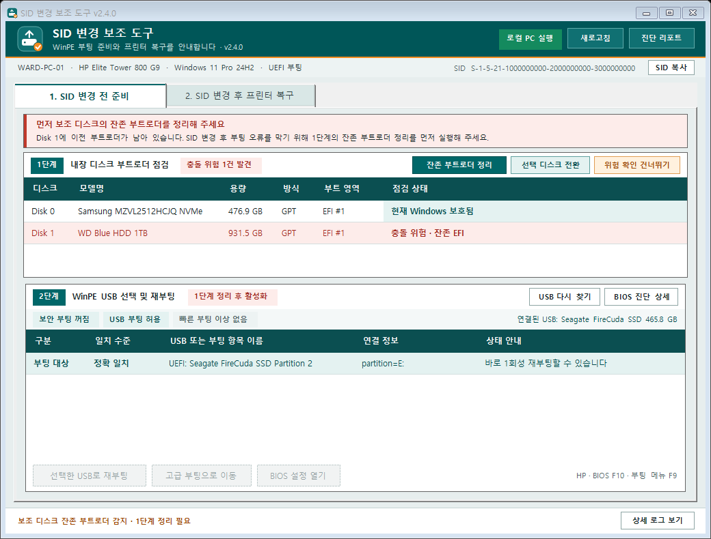

# SID 변경 보조 도구 (`SID_Change_Aux_Tool.bat`)

복제한 PC에서 WinPE USB로 윈도우 SID를 바꿀 때, 작업 전·후로 자주 겪는 두 가지 문제를 해결해 주는 도구입니다.

1. **SID 바꾸기 전:** PC 안에 보조 하드디스크나 SSD가 더 달려 있으면, 거기에 남아 있던 예전 부팅 정보 때문에 SID 변경 후 윈도우가 안 켜지거나 자동 복구 화면에 빠지는 일이 생깁니다. 이 도구가 충돌 위험을 미리 찾아 정리해 주고, 이어서 WinPE USB로 바로 재부팅할 수 있게 도와줍니다.
2. **SID 바꾼 뒤:** SID 변경을 마치고 나면 공유폴더는 잘 열리는데 **공유 프린터 인쇄만 안 되는 현상**이 자주 나타납니다. 버튼 한 번으로 인쇄 대기열과 스풀러 서비스를 다시 정리해 인쇄가 되도록 복구합니다.

별도 설치 없이 **`SID_Change_Aux_Tool.bat` 파일 하나만** 받아서 더블클릭하면 바로 열립니다.

---

## 다운로드 및 실행하기

* **다운로드:** 오른쪽(또는 상단) **[Releases](../../releases/latest)** 메뉴에서 최신 버전의 `SID_Change_Aux_Tool.bat` 파일을 내려받으세요.
* **실행 방법:** 내려받은 `SID_Change_Aux_Tool.bat` 파일을 **더블클릭**하면 관리자 권한 확인 창이 뜬 뒤 프로그램 화면이 열립니다.
* **어디에 두고 실행해도 안전합니다:**
  * 바탕화면이나 로컬 폴더, **쓰기 금지(읽기 전용) USB**, **공유폴더** 어디에서 실행하든 원본 파일이나 USB에는 아무것도 기록하지 않습니다.
  * **공유폴더나 네트워크 드라이브(`Z:` 등)에서 실행할 때:** 마우스 우클릭 `관리자 권한으로 실행` 대신 **그냥 더블클릭**해 주세요. 우클릭으로 관리자 실행을 하면 윈도우 보안 구조상 공유폴더 연결이 끊어질 수 있는데, 그냥 더블클릭하면 알아서 안전하게 권한을 올려 실행합니다.

---

## 순서대로 따라 하기

### 1. SID 바꾸기 전에 (`1. SID 변경 전 준비` 탭)

프로그램을 실행하면 먼저 `1. SID 변경 전 준비` 화면이 열리고 PC 상태를 자동으로 확인합니다.

#### ① 내장 디스크 점검 확인하기 (1단계)

* **이상 없음**이라고 표시되면 손댈 것 없이 바로 아래 2단계로 내려가면 됩니다.
* 만약 보조 디스크에 **`충돌 위험 · 잔존 EFI`** 또는 **`충돌 위험 · 잔존 MBR`**이 빨갛게 표시되면, 오른쪽 위의 **`잔존 부트로더 정리`** 버튼을 먼저 눌러 주세요.
  * 디스크를 포맷하거나 내 파일을 지우지 않고, 문제가 되는 부팅 폴더 이름만 잠시 바꿔 두기 때문에 데이터는 그대로 보존됩니다.
  * 정리가 끝난 뒤 *"현재 Windows 디스크를 UEFI 부팅 1순위로 등록할까요?"* 창이 뜨면 **`예`**를 눌러 주세요.



#### ② WinPE USB 고르고 재부팅하기 (2단계)

1단계 점검이 끝났다면 WinPE 부팅 USB(또는 외장 SSD)를 확인합니다. **`(EFI) + (부팅파일) + (일반 저장 공간)`처럼 파티션이 여러 개로 나뉜 PhoenixPE·DISM++·Rufus 부팅 USB**에 이 파일을 넣어 실행한 경우에도 자기 USB를 **`실행 USB`**로 알아서 찾아 선택해 줍니다(방금 새로 꽂았다면 **`USB 다시 찾기`**를 누르세요).

* **`실행 USB` · `부팅 대상` · `부팅 디스크`(`EFI 직접 부팅`)로 표시될 때:** 목록에 뜬 USB 이름과 용량이 맞는지 확인하고 **`선택한 USB로 재부팅`**만 누르면 됩니다. 윈도우가 켜진 상태에서 방금 꽂은 USB라도 EFI 부팅 경로를 자동으로 잡아 **이번 한 번만 해당 USB로 바로 부팅**되고, 작업이 끝나면 원래 윈도우로 켜집니다.
* **`BIOS에서 USB 부팅이 차단됨`이 뜰 때:** **`BIOS 설정 열기`**를 눌러 USB 부팅 허용으로 바꾼 뒤 다시 시도해 주세요.
* **직접 부팅 등록이 제한된 일부 보안 보드일 때:** 안내 창에 따라 **`고급 부팅으로 이동`**을 누른 뒤 파란 화면의 **`장치 사용`** 메뉴에서 USB를 선택해 주세요.


---

### 2. SID 바꾼 뒤에 (`2. SID 변경 후 프린터 복구` 탭)

WinPE에서 SID 변경 작업을 마치고 윈도우로 정상 부팅했다면, 공유 프린터가 먹통이 되지 않도록 스풀러를 한 번 비워 줍니다.

1. 프로그램을 실행하고 위쪽의 **`2. SID 변경 후 프린터 복구`** 탭을 누릅니다.
2. 이 PC가 프린터가 직접 꽂혀 있는 **메인 프린터 PC**인지, 받아 쓰는 **클라이언트 PC**인지 화면에 자동으로 표시됩니다.
3. 아래쪽의 **`프린터 스풀러 초기화`** 버튼을 누르고 잠시 기다립니다.
4. **메인 프린터 PC에서 한 번, 프린터를 연결해 쓰는 각 자리(클라이언트 PC)에서도 한 번씩** 실행한 뒤 테스트 인쇄를 해 보세요.

> 기존에 설치해 둔 프린터 목록이나 드라이버, 공유 설정은 지워지지 않으니 안심하고 실행하셔도 됩니다.


---

### 3. 혹시 작업 후 윈도우가 안 켜질 때 (비상 복구)

만약 작업 도중 부팅 순서가 꼬여 윈도우가 바로 켜지지 않는다면, **WinPE USB로 부팅한 상태에서 똑같은 `SID_Change_Aux_Tool.bat` 파일을 실행**해 보세요.

윈도우가 아닌 WinPE 환경임을 자동으로 알아채고 **WinPE 비상 복구 창**이 열립니다. 여기서 디스크를 선택해 **`선택 디스크 전환`**을 누르면 앞서 정리했던 부팅 폴더를 원래 상태 그대로 되돌릴 수 있습니다.

---

## 자주 막히는 상황 해결하기

* **Q. 부팅 USB를 꽂았는데 `부팅 시도 가능`이라고 뜨거나 부팅 파일 미확인 안내가 나옵니다.**
  * 부팅용으로 만든 USB(숨김 파티션 포함)라면 **`선택한 USB로 재부팅`**을 누를 때 숨김 EFI 영역을 자동으로 찾아 부팅을 시도합니다. 일반 자료용 USB가 아니라면 **`고급 부팅으로 이동`**의 `장치 사용` 메뉴나 부팅 단축키(`F9`/`F12` 등)로도 진입할 수 있습니다.
* **Q. 스풀러 초기화를 양쪽 PC에서 다 했는데도 공유 프린터가 안 됩니다.**
  * 2번 탭의 네 번째 카드(`공유 보안 상태` 또는 `메인 PC 연결`)를 확인해 보세요. 메인 PC 네트워크가 **`공용 네트워크`**로 잡혀 있거나 방화벽 공유 규칙이 꺼져 있으면 다른 자리에서 프린터에 접속할 수 없습니다. 윈도우 네트워크 설정에서 `개인 네트워크`로 바꿔 주세요.
* **Q. 작업 중 오류 창이 뜨거나 담당자에게 상태를 전달해야 합니다.**
  * 화면 오른쪽 위의 **`진단 리포트`** 버튼을 누른 뒤 **`로컬 폴더에 저장`** 또는 **`클립보드에 복사`**를 누르면 PC 모델, BIOS 상태, 디스크 구성, 작업 기록이 텍스트 파일 하나로 정리됩니다(비밀번호 등 민감 정보는 자동으로 가려집니다).
* **Q. 화면 단축키가 있나요?**
  * `F5`를 누르면 디스크·USB·프린터 상태를 새로고침하고, `Alt + 1` / `Alt + 2`로 상단 탭을 바로 오갈 수 있습니다.

---

## 제조사별 BIOS 진입 및 부팅 메뉴 단축키

전원을 켜자마자 로고가 뜨기 전에 아래 키를 여러 번 눌러 진입할 수 있습니다.

| 제조사 | BIOS 설정 | 부팅 메뉴 (1회 선택) | USB 부팅이 안 될 때 확인할 메뉴 |
| :--- | :---: | :---: | :--- |
| **HP** | `F10` (구형 `Esc`) | `F9` | `Advanced > Boot Options`에서 `USB Storage Boot`(또는 `Removable Media Boot`) 켜기, `Fast Boot` 끄기 |
| **Dell** | `F2` | `F12` | `Boot Configuration`에서 `Enable USB Boot Support` 켜기, `Fastboot`는 `Thorough` 권장 |
| **삼성 (Samsung)** | `F2` | `F10` 또는 `F12` | `Boot`에서 `Fast BIOS Mode` 끄기, 필요 시 `Secure Boot Control` 끄기 |
| **레노버 (Lenovo)** | `F1` | `F12` | `Startup`에서 `USB Boot` 켜기, 필요 시 `Security > Secure Boot` 끄기 |
| **LG** | `F2` | `F10` | `Boot`에서 `Fast Boot` 끄기, 필요 시 `Security > Secure Boot` 끄기 |
| **ASUS / ASRock** | `F2` / `Del` | `F8` / `F11` | `Boot`에서 `Fast Boot` 끄기, `Secure Boot` 끄기(ASUS는 `Other OS`) |
| **Gigabyte / MSI** | `Del` | `F12` / `F11` | `Boot`에서 `Fast Boot` 끄기, `Secure Boot` 끄기 |

---

<details>
<summary><strong>관리자 및 개발자 참고 사항 (지원 환경 · 내부 동작 · 빌드 방법)</strong></summary>

### 1. 지원 환경 및 주요 기술 사양 (`v2.4.0`)

* **지원 OS:** Windows 10 / 11 (UEFI 및 Legacy MBR — 사후 프린터 복구는 Legacy PC에서도 지원), WinPE (`X:`)
* **외부 의존성:** 없음 (Windows 기본 내장 PowerShell 5.1, GAC `System.Windows.Forms`, `diskpart`, `bcdedit`, `bcdboot`, `mountvol`, `shutdown`만 사용하며 임시 DLL·`csc.exe` 컴파일을 발생시키지 않음)
* **현장 장비 및 외장 매체 대응:**
  * 병원 내 주요 데스크톱 자산 코드(`S4/S5/S8/S9`, `H0/H1/H2/H3/H4/HS/H6/H8`, `D1/D8`) 및 CPU 세대 교차 식별
  * **다중 파티션 WinPE USB(`PhoenixPE Builder`, `DISM++`, `Rufus UEFI:NTFS`, `Bootice`, `Ventoy`) 완벽 지원:** `(EFI) + (부팅파일) + (일반 내장 공간)` 구성에서 일반 공간에 둔 도구를 직접 실행할 때 자기 USB(`실행 USB`)를 자동 식별·선택하며, GPT 복구 GUID(`{de94bba4-...}`)·숨김 MBR(`0x12/0x17/0x27`)·무마운트 VBR 시그니처 탐색 및 `DISM++` `"Windows Boot Manager"` USB 항목 매칭, Windows 실행 중 연결(Hot-Plug)된 USB의 **1회성 UEFI EFI 직접 부팅 등록(`Invoke-DirectUsbEfiBootSetup`)**을 지원
  * UASP 외장 NVMe/SATA 인클로저(`Realtek RTL9210B-CG`, `HSEN 10G-NVME`, `JMicron`, `ASMedia`, `FireCuda` 등)를 PnP `ContainerID` 기준으로 정확히 분류하되, 내장 AHCI 핫플러그 SATA 디스크나 마운트된 `.vhdx` 가상 디스크는 외장 USB로 오분류하지 않도록 보호
  * 드라이브 문자가 없는 숨김 EFI/Ventoy(`VTOYEFI`)/Rufus 파티션을 인메모리 `QueryDosDeviceW`(`\Device\HarddiskVolumeX`) 및 `\\?\Volume{GUID}\` 무마운트 탐색으로 매칭하고, 분리된 예전 장치가 남긴 `device = unknown` 유령 NVRAM 항목 및 USB 유선랜(PXE) 항목 오매칭을 차단
  * 부팅 방식 3중 신호 및 보안 부팅 4중 신호(`Confirm-SecureBootUEFI` + 커널 레지스트리 + `Win32_DeviceGuard` + HP/Dell/Lenovo WMI) 교차 검증 지원 (삼성 AMI 등 WMI 미지원 보드는 임의로 `허용`으로 추정하지 않음)
* **콘솔 전용 실행:** GUI를 띄울 수 없는 환경에서는 자동으로 텍스트 메뉴로 전환되며, 강제로 콘솔 모드를 열 때는 `SID_Change_Aux_Tool.bat --cli`로 실행합니다.
* **USB 루트 바로가기(`.lnk`) 만들기 팁:** USB 최상위에 바로가기를 둘 때 대상에 `cmd.exe /c start "" "\유틸리티\SID_Change_Aux_Tool.bat"`, 시작 위치에 `\`, 실행 크기에 `최소화`를 넣으면 드라이브 문자가 바뀌어도 동작합니다.

### 2. 소스 빌드 및 자동 테스트

배포 파일인 [`SID_Change_Aux_Tool.bat`](SID_Change_Aux_Tool.bat)는 직접 수정하지 않고, `modules/` 폴더의 모듈을 수정한 뒤 빌드 스크립트로 생성·검증합니다(`100% 순수 ASCII` 및 `CRLF` 강제).

```powershell
# 현재 VERSION 기준 빌드 및 무결성 검증
powershell -STA -NoProfile -ExecutionPolicy Bypass -File tools\Build-Tool.ps1

# 버전 자동 증가(Patch / Minor / Major) 후 빌드
powershell -STA -NoProfile -ExecutionPolicy Bypass -File tools\Build-Tool.ps1 -Bump Patch

# 전체 자동 테스트 (단위 + 기종/UASP/숨김 ESP/유령 NVRAM + BIOS 교차 검증 + GUI 레이아웃 감사 + 버전 정합성)
powershell -STA -NoProfile -ExecutionPolicy Bypass -File tools\Test-Tool.ps1
```

* 버전 원본: [`VERSION`](VERSION)
* 전체 변경 이력: [`CHANGELOG.md`](CHANGELOG.md)
* 상세 기술 인수인계서: [`HANDOVER.md`](HANDOVER.md)
* 설계 의사결정 기록: [`docs/DIRECTION_AND_DECISIONS.md`](docs/DIRECTION_AND_DECISIONS.md)

</details>
