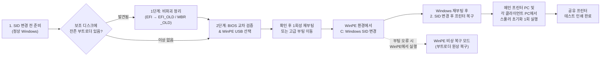
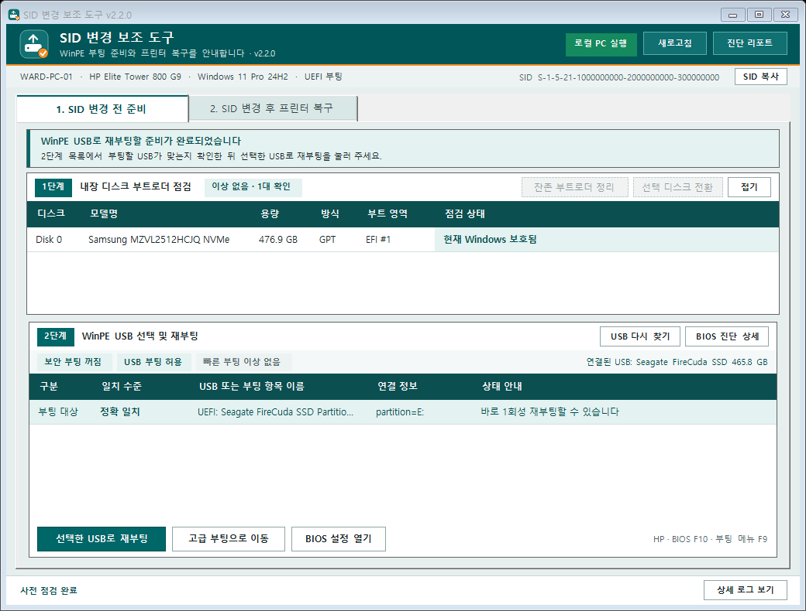
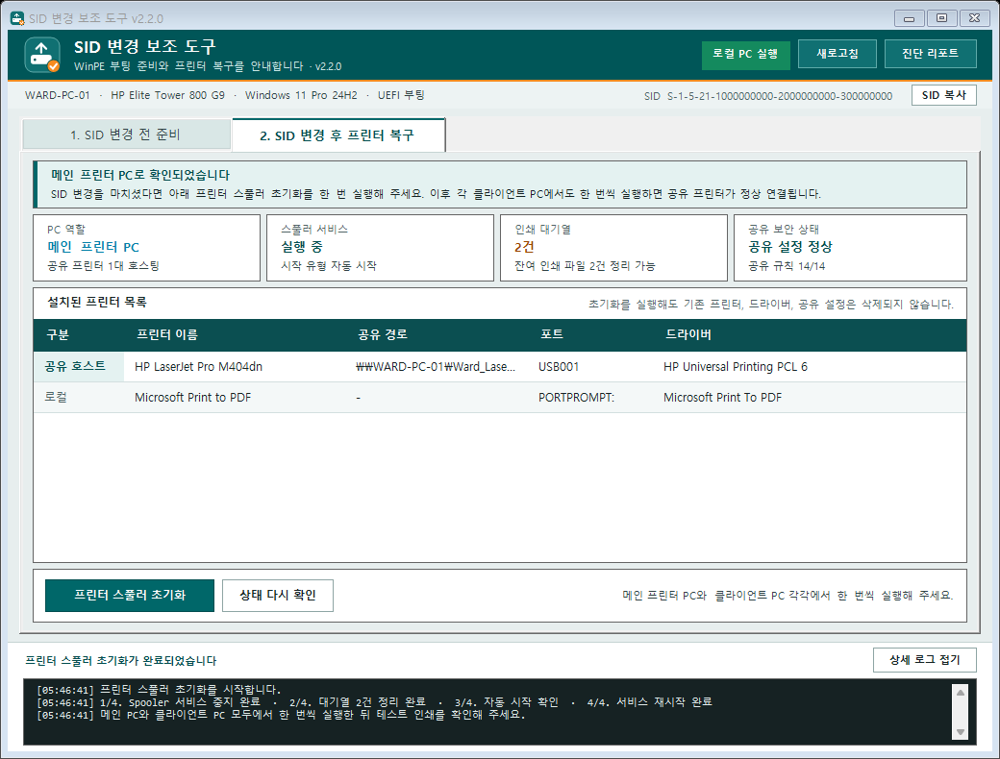

# SID 변경 사전·사후 보조 도구 (`SID_Change_Aux_Tool.bat`)


골든 이미지 복제 PC에서 **WinPE 부팅 USB로 C 드라이브의 Windows SID를 변경할 때, 작업 전·후에 반복되는 부팅 충돌과 공유 프린터 먹통 문제를 한 번에 예방·해결하는 단일 실행 파일 도구**입니다.

별도 설치나 외부 프로그램 없이 **[`SID_Change_Aux_Tool.bat`](SID_Change_Aux_Tool.bat) 파일 1개만** 복사해 바로 실행할 수 있으며, 쓰기 금지 USB·로컬 PC·사내 공유폴더 환경 모두에서 원본 파일 변경 없이 안전하게 동작합니다.

---

## 전체 작업 흐름



---

## 화면 미리보기

### 1. SID 변경 전 준비 — 정상 준비 완료

내장 디스크 점검을 통과하고 WinPE USB가 UEFI 펌웨어 목록과 매칭되면, 상단 안내 배너가 녹색으로 바뀌며 **선택한 USB로 재부팅** 버튼이 활성화됩니다.



### 2. SID 변경 전 준비 — 보조 디스크 잔존 부트로더 감지 및 2단계 자동 잠금

C 드라이브 외 보조 HDD/SSD에 이전 Windows의 EFI 또는 MBR 부트로더가 남아 있으면 **1단계에서 충돌 위험을 경고**하고, 정리하기 전까지 **2단계 USB 재부팅 버튼을 자동으로 잠급니다**(점선 비활성 버튼에 마우스를 올리면 잠금 사유와 해결 방법이 표시됩니다).


### 3. SID 변경 후 프린터 복구 — 메인 PC / 클라이언트 자동 판별 및 스풀러 초기화

PC가 공유 프린터를 호스팅하는 **메인 프린터 PC**인지 **클라이언트 PC**인지 자동으로 판별해 핵심 상태를 4개 카드로 보여 줍니다. **프린터 스풀러 초기화**는 백그라운드에서 실행되어 창이 멈추지 않으며, 하단 상세 로그에서 4단계 진행 과정을 실시간으로 확인할 수 있습니다.



---

## 핵심 기능 명세

| 영역 | 주요 기능 | 안전·편의 설계 |
| :--- | :--- | :--- |
| **사전 1단계**<br/>내장 디스크 부트로더 점검 | C 드라이브 외 내장 디스크의 잔존 **GPT EFI** 및 **MBR 활성 부트로더** 탐지·비파괴 비활성화 | 파티션 삭제·포맷 금지(`EFI ↔ EFI_OLD`, `bootmgr/Boot ↔ _OLD` + `inactive/active`). 현재 Windows·외장 USB·WinPE 매체·읽기 전용 디스크 자동 보호 |
| **사전 2단계**<br/>BIOS 교차 검증 & USB 부팅 | 부팅 방식·보안 부팅 3중 신호 교차 검증, HP/Dell WMI 정밀 진단, 물리 USB·UEFI NVRAM 4단계 매칭 | WMI 미지원 보드(삼성 AMI 등) `허용` 오추정 금지, HP `Legacy USB Boot` 오탐 차단, 반드시 사용자 확인 후 1회성 재부팅(`bootsequence`) |
| **사후 복구**<br/>프린터 스풀러 초기화 | `Spooler` 및 의존 서비스 중지 → `PRINTERS` 대기열 정리 → `Disabled` 시작 유형 자동 복구 → 서비스 재시작 | 기존 프린터·드라이버·공유 설정 비삭제, 호스트(방화벽·네트워크 프로필) / 클라이언트(원격 SMB 응답) 상태 진단, 비동기 실행으로 UI 멈춤 방지 |
| **WinPE 비상 복구**<br/>(`X:` 환경 자동 진입) | WinPE에서 실행 시 자동으로 비상 복구 창 진입, 내장 디스크 GPT EFI / MBR 부트로더 즉시 복구·전환 | Storage 모듈이 없는 경량 WinPE에서도 `diskpart`(영문·한글) 파서로 자동 폴백 |
| **진단 리포트 & 폴백** | BIOS 교차 검증 근거·NVRAM 원본·디스크 구성·작업 로그 통합 조회 및 파일 저장·클립보드 복사 | 오류 시 민감정보 자동 마스킹(`[REDACTED]`) 후 로컬 폴더 저장 안내, GUI 불가 환경 또는 `--cli` 실행 시 콘솔 모드 자동 전환 |

---

## 실행 방법

### 1. 실행 매체별 권장 방법

| 실행 위치 | 실행 방법 | 참고 사항 |
| :--- | :--- | :--- |
| **로컬 PC** | `SID_Change_Aux_Tool.bat` 더블클릭 | 관리자 권한(UAC) 자동 요청 후 GUI 실행 |
| **쓰기 금지 USB** | USB 내 `SID_Change_Aux_Tool.bat` 더블클릭 | USB에 파일을 전혀 쓰지 않고 메모리에서 실행 |
| **공유폴더 / 네트워크 드라이브 (`Z:\`)** | **일반 더블클릭 권장** | 우클릭 `관리자 권한으로 실행` 대신 일반 더블클릭하면 로컬 임시 스테이징 후 메모리로 로드되며 임시 파일은 즉시 자동 삭제됨 |
| **콘솔 전용 모드** | `SID_Change_Aux_Tool.bat --cli` | GUI 없이 텍스트 메뉴로 실행해야 할 때 사용 |

> **USB 상대 경로 바로가기 팁:** USB 루트에 바로가기(`.lnk`)를 둘 때는 대상에 `cmd.exe /c start "" "\유틸리티\SID_Change_Aux_Tool.bat"`, 시작 위치에 `\`, 실행 옵션에 `최소화`를 지정하면 드라이브 문자가 바뀌어도 항상 동작합니다.

### 2. 단축키

* `F5`: 전체 상태(디스크·USB·BIOS·프린터) 새로고침
* `Alt + 1`: **1. SID 변경 전 준비** 탭으로 이동
* `Alt + 2`: **2. SID 변경 후 프린터 복구** 탭으로 이동

---

## 단계별 사용 가이드

### A. SID 변경 전 준비 (1번 탭)

1. **1단계 — 내장 디스크 부트로더 점검**
   * `이상 없음`으로 표시되면 별도 조치 없이 바로 2단계로 진행합니다.
   * 보조 디스크에 `충돌 위험 · 잔존 EFI` 또는 `충돌 위험 · 잔존 MBR`이 표시되면 **잔존 부트로더 정리** 버튼을 눌러 비활성화해 주세요.
   * 정리 후 나타나는 `UEFI 부팅 1순위 등록` 확인 창에서 `예`를 누르면 현재 Windows SSD가 1순위로 재등록됩니다.
2. **2단계 — WinPE USB 선택 및 재부팅**
   * WinPE 부팅 USB를 연결한 뒤 **USB 다시 찾기**를 누릅니다.
   * 목록에 `부팅 대상`으로 표시되면 항목을 확인하고 **선택한 USB로 재부팅**을 눌러 1회성 재부팅을 진행합니다.
   * Windows 부팅 이후 USB를 꽂아 `NVRAM 미등록`으로 표시되면 **고급 부팅으로 이동**을 눌러 파란 화면의 `장치 사용`에서 USB를 선택해 주세요.
   * BIOS에서 USB 부팅이 차단되었거나 보안 부팅이 켜져 있다면 **BIOS 설정 열기**를 눌러 설정을 변경해 주세요.

### B. SID 변경 후 프린터 복구 (2번 탭)

1. WinPE에서 SID 변경을 마치고 Windows로 정상 부팅한 뒤 도구를 실행해 **2. SID 변경 후 프린터 복구** 탭을 엽니다.
2. **프린터 스풀러 초기화** 버튼을 눌러 대기열을 비우고 서비스를 재시작합니다.
3. 공유 프린터를 연결해 쓰는 **메인 프린터 PC**와 **각 클라이언트 PC**에서 각각 한 번씩 실행한 뒤 테스트 인쇄로 정상 동작을 확인합니다.

> 기존에 설치된 프린터, 드라이버, 공유 설정은 삭제되지 않습니다.

### C. 부팅 이상 시 WinPE 비상 복구

* 만약 SID 작업 후 Windows 부팅이 꼬였다면 WinPE로 부팅한 상태에서 동일한 `SID_Change_Aux_Tool.bat`를 실행하세요.
* 자동으로 **WinPE 비상 복구 모드**가 열리며, 비활성화했던 디스크를 선택해 **선택 디스크 전환**으로 즉시 원상 복구할 수 있습니다.

---

## 제조사별 BIOS 진입 및 부팅 메뉴 단축키

| 제조사 | BIOS 설정 진입 | 부팅 메뉴 (1회 선택) | 주요 확인 항목 |
| :--- | :---: | :---: | :--- |
| **HP** | `F10` | `F9` | `Advanced → Boot Options → USB Storage Boot (Enable)`, `Fast Boot (Disable)` |
| **Dell** | `F2` | `F12` | `Boot / USB Config → Enable USB Boot Support (On)`, `Fastboot (Thorough)` |
| **Samsung** | `F2` | `F10` / `F12` | `Boot → Fast BIOS Mode (Disabled)`, `Secure Boot Control (Disabled)` |
| **Lenovo** | `F1` | `F12` | `Startup → USB Boot (Enabled)`, `Security → Secure Boot (Disabled)` |
| **LG** | `F2` | `F10` | `Boot → Fast Boot (Disabled)`, `Security → Secure Boot (Disabled)` |
| **ASUS / ASRock** | `F2` / `Del` | `F8` / `F11` | `Boot → Fast Boot (Disabled)`, `Secure Boot (Disabled / Other OS)` |
| **Gigabyte / MSI** | `Del` | `F12` / `F11` | `Boot → Fast Boot (Disabled)`, `Secure Boot (Disabled)` |

---

## 지원 환경 및 안전 원칙

* **지원 OS:** Windows 10 / 11 (UEFI 및 Legacy MBR — 사후 프린터 복구는 Legacy 환경에서도 정상 동작), WinPE (`X:`)
* **필수 권한:** 관리자 권한 (미보유 시 자동 UAC 상승)
* **외부 의존성:** 없음 (Windows 기본 내장 PowerShell 5.1, `diskpart`, `bcdedit`, `bcdboot`, `mountvol`, `shutdown`, GAC WinForms만 사용)
* **절대 안전 원칙:**
  1. `SID_Change_Aux_Tool.bat`는 100% 순수 ASCII·CRLF 단일 파일로 한글 Windows/영문 WinPE 어디서나 코드페이지 깨짐 없이 실행됩니다.
  2. 파티션 삭제(`delete partition`)·포맷(`format`)은 일절 수행하지 않으며, 모든 부트로더 조치는 언제든 되돌릴 수 있습니다.
  3. USB가 1개만 감지되어도 절대 자동 재부팅하지 않고 반드시 사용자 확인을 거칩니다.
  4. WMI로 확인할 수 없는 보드(삼성 AMI 등)의 USB 부팅 옵션을 임의로 `허용`으로 추정하지 않습니다.

---

## 개발 및 유지보수 안내

배포 파일 [`SID_Change_Aux_Tool.bat`](SID_Change_Aux_Tool.bat)를 직접 수정하지 않고, `modules/`의 소스 모듈을 수정한 뒤 빌드·검증 스크립트로 재생성합니다.

```powershell
# 현재 VERSION 기준 빌드 및 무결성 검증
powershell -STA -NoProfile -ExecutionPolicy Bypass -File tools\Build-Tool.ps1

# 버전 자동 증가(Patch / Minor / Major) 후 빌드
powershell -STA -NoProfile -ExecutionPolicy Bypass -File tools\Build-Tool.ps1 -Bump Patch

# 전체 자동 테스트 (152개: 단위 + BIOS 교차 검증 + WinForms GUI 레이아웃 감사 + 버전 정합성)
powershell -STA -NoProfile -ExecutionPolicy Bypass -File tools\Test-Tool.ps1
```

* 버전 기준 파일: [`VERSION`](VERSION)
* 전체 변경 이력: [`CHANGELOG.md`](CHANGELOG.md)
* 기술 인수인계 및 실장비 검증 체크리스트: [`HANDOVER.md`](HANDOVER.md)
* 설계 방향 및 의사결정 기록: [`docs/DIRECTION_AND_DECISIONS.md`](docs/DIRECTION_AND_DECISIONS.md)
